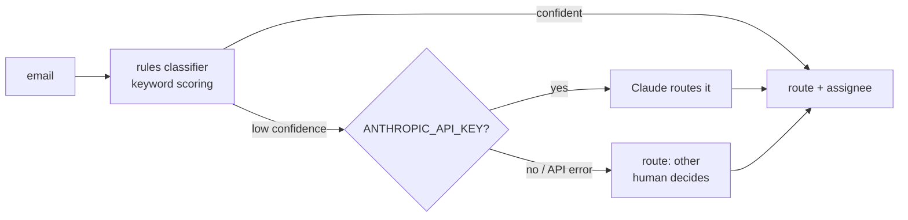

# inbox-triage-bot

Shared-inbox triage for a small service business: route email to the right person,
surface what's urgent, kill the spam, and hand the owner a morning digest instead of
40 unread messages. **Works fully offline; Claude is an optional upgrade, not a
dependency.**

## Run it

```bash
python3 gen_data.py   # sample inbox: bookings, billing, an angry one, spam, an emergency
python3 triage.py     # -> triage_digest.md
python3 -m unittest   # no network needed

# optional: escalate the ambiguous ones to Claude
ANTHROPIC_API_KEY=sk-... python3 triage.py
```

```
10 emails triaged: billing 2, booking 2, complaint 1, other 3, sales 1, spam 1 | 1 urgent | rules only (no API key set)
```

## The hybrid design (the interesting part)



- **Rules handle the boring 80%** — free, instant, deterministic, fully testable.
- **The LLM only sees the ambiguous 20%** (low rule confidence). That's the
  cost-effective place for a model: judgment calls, not keyword matches.
- **Every LLM failure degrades to rules**, never to a crash. A triage bot that goes
  down when an API hiccups is worse than no triage bot.

Two routing details that matter in practice:

- **Complaints outrank everything on overlap.** An angry email about an invoice goes to
  the *owner*, not to billing — misrouting anger is how it becomes a review.
- **"other" is an honest answer.** Below the confidence floor the bot refuses to guess;
  an email routed wrong is worse than an email left for a human.

## Design decisions

- Route table (keywords + assignee) is data at the top of the file — ops can tune it.
- Urgency is orthogonal to routing: an urgent *booking* and an urgent *complaint* both
  hit the red section — but urgent *spam* doesn't ("URGENT limited offer!" is a test case).
- Claude call is raw `urllib` against the Messages API — no SDK, ~20 lines, easy to audit.

## Production notes

- Feed it real email via IMAP poll, Gmail API, or a forwarding address into a webhook.
- Actions (label, assign, forward) map onto the `assign` field — Gmail labels or
  helpdesk API calls.
- Log the LLM's routing decisions and periodically fold the patterns back into the
  keyword table: the model's judgment becomes tomorrow's free rules.
